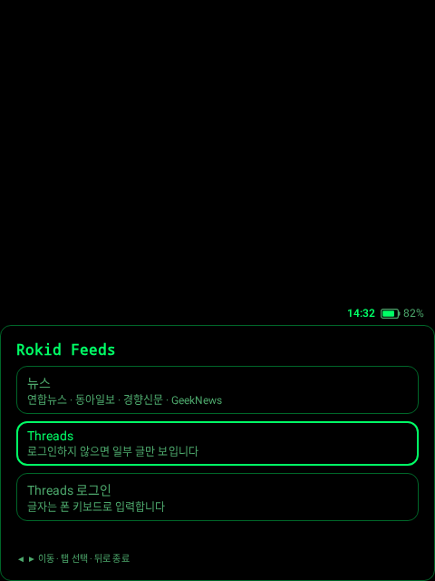
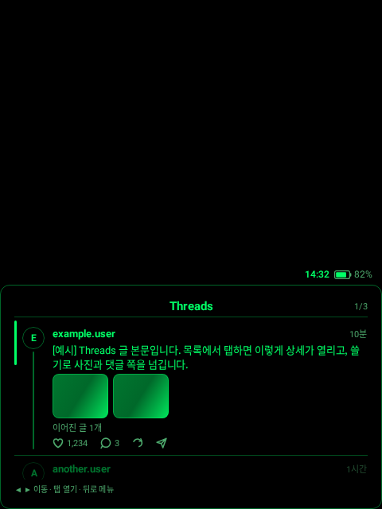
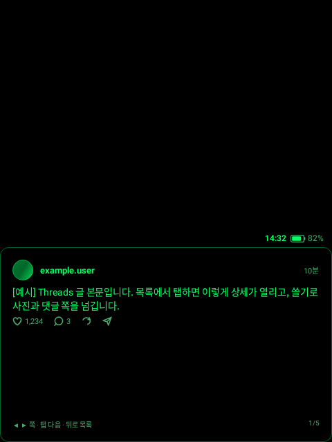
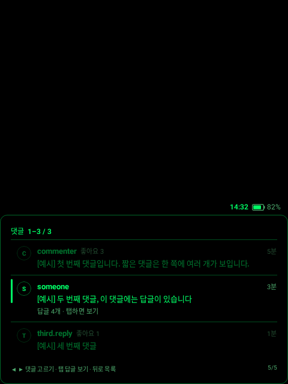
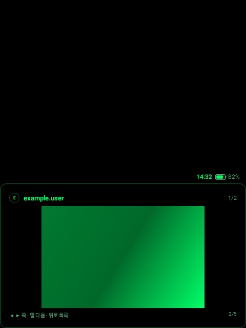
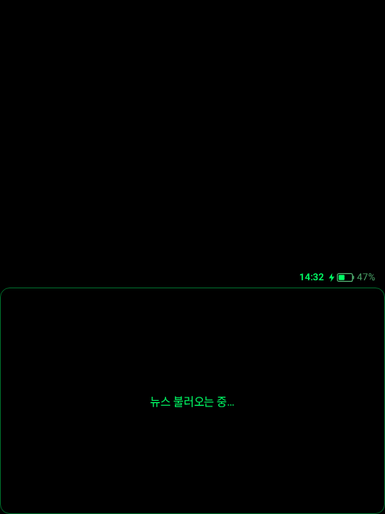
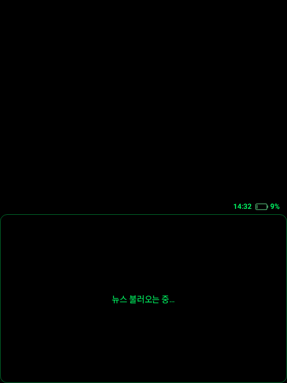
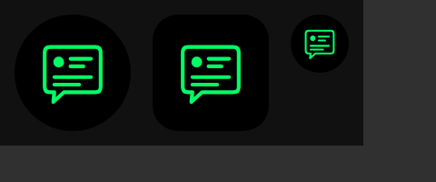

# Rokid Feeds

Rokid 안경용 읽기 앱입니다. 메인 메뉴에서 **뉴스**와 **Threads**를 고릅니다.

- **뉴스**: 연합뉴스·동아일보·경향신문 RSS와 GeekNews(Atom)를 **하나의 통합 목록**(소스별 10개씩, 총 40개, 소스를 번갈아 끼워 넣음)으로 보여 주고, 기사를 열면 제목·언론사·기자·시간·본문·링크를 쪽 단위로 보여 줍니다.
- **Threads**: threads.com의 글·댓글·답글·사진을 Threads 앱 모양(아바타·이름·아이콘 줄, 상자 대신 구분선)으로 보여 줍니다. 아래 [Threads](#threads)를 보세요.

화면 전체가 아래쪽 **480 × 282 띠** 안에 그려지고, 띠 위쪽은 검은색이라 안경에서는 투명하게 보입니다. rokid-lens, rokid-youtube, rokid-conversate, rokid-glass-ios-navigation과 같은 방식입니다(화면 크기·색·입력·Wi-Fi·OTA).

## 화면

| 메인 메뉴 | Threads 목록 | Threads 글 | Threads 댓글 (고른 댓글 → 탭하면 답글) |
|---|---|---|---|
|  |  |  |  |

| Threads 사진 (녹색 단색) | 배터리: 충전 중 | 배터리: 낮음 | 앱 아이콘 |
|---|---|---|---|
|  |  |  |  |

| 뉴스 통합 목록 | 상세 1쪽 | 상세 2쪽 (본문 받는 중) |
|---|---|---|
|  |  |  |

| 인터넷 없음 (Wi-Fi 켜는 중) | 불러오기 실패 + 새 버전 알림 | 일부 언론사 실패 |
|---|---|---|
|  |  |  |

위 그림은 [Paparazzi](https://github.com/cashapp/paparazzi)가 실제 Compose 코드로 그린 480×640 화면입니다. 기사·글·사진은 예시입니다(사진은 색 그라데이션으로 녹색 단색 필터를 보여 줌).

- 띠: 여백 18, 강조 `#00ff66`, 보조 `#4da86c`, 얇은 녹색 윤곽선. 밝은 면은 앞을 가리므로 만들지 않습니다.
- 띠 바로 위: 왼쪽 업데이트, 가운데 Wi-Fi·인터넷 상태(또는 지난번 앱이 튕긴 이유), 오른쪽 시각·배터리 아이콘(잔량만큼 채움, 충전 중이면 번개, 15% 이하면 숫자 굵게).

## 조작

| 동작 | 메인 메뉴 | 목록 (뉴스·Threads) | 뉴스 상세 | Threads 글 |
|---|---|---|---|---|
| 앞/뒤로 쓸기 · 링 앞/뒤 | 다음/이전 줄 (순환) | 다음/이전 글 (**양끝에서 순환**) | 다음/이전 쪽 (**끝에서 멈춤**) | 다음/이전 쪽, 댓글 쪽에서는 댓글을 하나씩 고름 |
| 탭 · 링 탭 | 고르기 | 열기 (오류 화면에서는 다시 시도) | 다음 쪽 | 다음 쪽, 고른 댓글이면 **그 댓글을 열어 답글 보기** |
| 뒤로 · 링 두 번 탭 | 앱 종료 | 메인 메뉴 | 목록 (선택 위치 유지) | 이전 글(댓글을 열기 전) → 목록 |

- **안경 터치패드:** rokid-lens·rokid-youtube와 같은 키 매핑(`input/GlassesInput.kt`, RokidPipe에서 실기 확인된 것). 쓸기는 DPAD 좌우·183/184, 탭은 ENTER·202, 세로 쓸기(DPAD 위/아래)도 이전/다음. 한 번 쓸기에 두 번 들어오는 이벤트는 240ms 디바운스로 거릅니다.
- **R08 링 ([R08 Access Bridge](https://github.com/Anezium/R08-Access-Bridge)):** 띠 위에 링 전용 노드(`input/RingTarget.kt`) 하나만 노출해서, 브리지가 보내는 스크롤 앞/뒤와 클릭을 위 동작으로 바꿉니다. 브리지가 꺼져 있을 때 들어오는 링 미디어 키도 같은 동작입니다.
- 내비게이션 규칙 전체는 Android 없는 순수 상태머신(`nav/Navigator.kt`)이며 "어떤 키 순서로도 뒤로를 두 번 이내로 누르면 종료에 닿음"을 테스트로 검증합니다.

## Threads

공식 Threads API로는 홈 피드를 가져올 수 없고 남의 글은 Meta 앱 심사가 필요해서, **threads.com 웹을 앱 안의 보이지 않는 WebView로 열고** 페이지가 받는 데이터에서 글을 꺼내 우리 화면으로 그립니다.

- **데이터**: `assets/threads_bridge.js`를 페이지에 넣어, 페이지가 받는 GraphQL 응답과 페이지에 박힌 JSON(`script[data-sjs]`) 중 글 데이터가 든 것만 앱으로 넘깁니다. `threads/ThreadsParser.kt`가 화면 HTML이 아니라 데이터 필드(`thread_items`, `caption.text`, `user.username`, `image_versions2`, `direct_replies`, `self_thread`)를 읽습니다(2026-11-11 확인한 모양). 구조가 바뀌면 빈 목록이 나올 뿐 앱이 죽지는 않습니다.
- **목록**: 홈(`threads.com/`)의 글. 목록 끝 세 줄 안으로 오면 페이지를 한 번 더 내려 다음 글을 받습니다(사람이 스크롤하는 만큼만).
- **글**: Threads 피드처럼 본문 아래 사진 줄. 탭 → 사진 크게(위아래로 다른 사진, 뒤로 글). 아래로 계속 넘기면 **댓글 목록**(한 줄씩 고름, 사진 있는 댓글도 작은 사진 줄). 댓글 탭 → 그 댓글을 글처럼 열어 답글·큰 사진. 댓글에서 뒤로 → 글, 글에서 뒤로 → 이전 글 → 목록(한 번 받은 글은 기억).
- **목록**: 고른 글은 띠 높이에 맞춰 본문 7줄(사진이 있으면 4줄), 넘치면 "… 탭하면 전체". 더 불러오기는 한 번에 하나, 연달아 3번 새 글이 없으면 목록 끝.
- **사진**: 띠 폭에 맞는 크기를 골라 받아 흑백 밝기를 녹색으로 그립니다. 이모지는 컬러로 그려지므로 글에서 뺍니다.
- **로그인 (폰 링크)**: 메인 메뉴 → "Threads 로그인"이면 안경에 주소(`server-v2…/login`)와 6자리 코드가 뜹니다. 폰에서 그 주소를 열고 코드·아이디·비밀번호를 보내면 안경이 숨은 WebView의 threads.com 로그인 폼(데스크톱 화면)에 넣고 누릅니다. 인증 코드가 필요하면 폰 페이지에 칸이 나타납니다. 중계는 rokid-conversate 서버의 `/login`·`/relay`(메모리에만, 안경이 가져가면 바로 지움, 10분 만료, 기록하지 않음). 쿠키는 WebView가 보관합니다. 로그인하지 않으면 공개 글 일부만 보입니다. 로그인돼 있으면 같은 줄이 "로그아웃"이 됩니다.
- **성능**: 숨은 WebView는 데이터를 받는 동안만 켜고(그 밖에는 GONE), 사진·동영상은 페이지가 받지 않게 막습니다. 프로필 사진은 받지 않고, 썸네일은 고른 줄에 0.7초 머물 때만 받습니다.
- **범위**: WebView는 threads.com·instagram.com(로그인 단계)만 엽니다. 글 데이터는 threads 주소에서 온 것만 받습니다.

**주의**: 웹 데이터를 꺼내 쓰는 방식이라 Meta 약관상 회색 지대이고(개인 열람용 가정), threads.com 구조가 바뀌면 고쳐야 합니다.

## 인터넷과 Wi-Fi

- 네트워크 고르기는 **시스템에 맡깁니다.** iPhone 핫스팟을 한 번 연결해 두면 안경이 저절로 다시 붙습니다. 앱이 네트워크를 직접 고르면 시스템 확인 창이 떠서 쓰지 않습니다.
- 안경은 배터리 때문에 Wi-Fi를 꺼 두는 일이 많습니다. 꺼져 있으면 10초마다 rokid-conversate의 **"Wi-Fi 켜기 도우미"** 앱(targetSdk 28)으로 켭니다. 도우미가 없으면 띠 위에 `Wi-Fi 꺼짐 · 도우미 앱 없음`이 뜹니다. 시스템 Wi-Fi 화면은 열지 않습니다.
- 피드를 못 받았는데 인터넷이 없으면 "인터넷 연결 없음"을 보여 주고, 연결이 돌아오면 저절로 다시 불러옵니다.
- iPhone 핫스팟은 연결된 기기가 없으면 잠듭니다. 단축어 자동화(블루투스 → Rokid 안경 연결될 때 → 개인용 핫스팟 켜기)를 쓰면 손대지 않고 연결됩니다(rokid-conversate `docs/rokid-dev-notes.md` 1장).

## 기사 본문

RSS 요약은 언론사가 잘라 줍니다(연합뉴스 83자, 동아일보 약 500자, 경향신문 203자, 2026-11-04 확인). 그래서 상세를 열면 원문 링크에서 본문을 받습니다.

- 규칙(`data/ArticleBody.kt`, 정규식, 소스별): 연합뉴스는 `story-news` 영역의 속성 없는 `<p>`, 경향신문은 `articleBody` 아래 `content_text` 문단, 동아일보는 `news_view` 영역에서 스크립트·사진을 걷어 낸 텍스트. 최대 2,400자에서 문장 끝으로 자르고 `…`을 붙입니다.
- 받는 동안은 RSS 요약을 보여 주고 아래에 "본문 불러오는 중…"을 띄웁니다. 실패하거나 요약보다 짧으면 요약을 그대로 씁니다.
- GeekNews는 본문을 받지 않습니다. 원문 페이지가 이 앱의 요청을 403으로 막고 자동 접속을 하지 말라고 안내합니다(2026-11-11 확인). 피드는 요약을 약 500자에서 항목 중간까지 잘라 `…`를 붙여 주므로, 끊긴 마지막 항목은 버리고 `… 원문에서 계속`으로 끝냅니다. 목록 항목은 `· `로 시작하는 한 줄이고, 쪽은 항목 경계에서 넘깁니다.
- 쪽 나누기(`util/Pager.kt`): 첫 쪽 200자(제목·메타가 함께 보임), 나머지 290자, 링크는 70자로 환산. 문단 → 문장 끝 → 공백 순으로 자릅니다.

## 빌드와 설치

```bash
./gradlew :app:assembleDebug
adb install -r app/build/outputs/apk/debug/app-debug.apk
```

릴리스(고정 키로 서명, OTA 서버에 올리기):

```bash
RELEASE_KEYSTORE=... RELEASE_KEYSTORE_PASS=... OTA_UPLOAD_TOKEN=... scripts/release.sh 0.1.0 --upload
```

처음 한 번은 케이블로 설치합니다. 그다음부터는 앱을 켤 때 알아서 업데이트됩니다(확인 창 없음).

```bash
adb install -r -i com.chorockkim.rokidfeeds rokid-feeds-0.1.0.apk
adb shell appops set com.chorockkim.rokidfeeds REQUEST_INSTALL_PACKAGES allow
adb shell appops set com.chorockkim.rokidfeeds SYSTEM_ALERT_WINDOW allow
```

OTA 서버(rokid-conversate server-v2)의 `OTA_PUBLIC_APPS`에 `rokid-feeds`가 있어야 합니다. Wi-Fi 자동 켜기에는 rokid-conversate의 `wifihelper` APK가 한 번 설치돼 있어야 합니다.

미리보기: `adb shell am start -n com.chorockkim.rokidfeeds/.MainActivity --es feed geeknews`면 GeekNews만 보여 줍니다.

## 테스트

```bash
./gradlew :app:testDebugUnitTest      # 내비게이션, 입력 매핑, 쪽 나누기, RSS·병합·본문 추출, HTTP 상한, OTA 응답, Wi-Fi 문구
./gradlew :app:recordPaparazziDebug   # 화면 스냅샷 → app/src/test/snapshots/images
```

## 구조

```
app/src/main/kotlin/com/chorockkim/rokidfeeds/
├── MainActivity.kt        # 띠 크기 맞추기(밀도), 키·링 → NavKey, Wi-Fi·네트워크·시각·배터리, OTA
├── RokidFeedsApp.kt       # 튕긴 이유 기록(다음 실행 때 표시), Updater
├── data/                  # NewsApi(병렬 받기·부분 실패), BoundedHttp, NewsMerge, RssParser, ArticleBody, Models
├── input/                 # GlassesInput(터치패드 키), RingTarget(R08 링), NavKeys(→ NavKey 매핑 한 곳)
├── nav/Navigator.kt       # 순수 내비게이션 상태머신
├── net/WifiEnabler.kt     # Wi-Fi 켜 두기(도우미 앱), 상태 문구
├── nav/AppNav.kt          # 메인 메뉴 상태머신, nav/ThreadDetailNav.kt: Threads 글 안 이동(댓글 고르기·열기)
├── threads/               # ThreadsWeb(숨은 WebView·로그인), ThreadsParser(JSON → 글), ThreadsSession(상태), ThreadPages, ThreadImages
├── ui/                    # GlassScreen(띠 + 상태 알약·배터리), AppRoot(메뉴 → 화면), NewsApp, ThreadsApp, Threads 화면(ThreadsLook), Theme
├── update/                # Updater(확인·받기·검증·설치), Release, InstallResultReceiver
└── util/                  # Pager, HtmlText, TimeAgo
```

## 뉴스 출처

| 언론사 | RSS | 결과 | 요약 길이(중앙값) |
|---|---|---|---|
| GeekNews | `https://news.hada.io/rss/news` | 200, 20개, Atom(2026-11-04) | 약 200~500자 |
| 연합뉴스 | `https://www.yna.co.kr/rss/news.xml` | 200, 120개 | 83자 |
| 동아일보 | `https://rss.donga.com/total.xml` | 200, 50개 | 약 500자 |
| 경향신문 | `https://www.khan.co.kr/rss/rssdata/total_news.xml` | 200, 50개 | 약 200자 |

사용하지 않은 피드: 한겨레는 요약이 비어 있고, SBS는 790KB라 안경에는 무겁고, 매일경제는 403(Cloudflare), KBS·YTN은 404, JTBC는 항목이 1개뿐이었습니다(2026-10-19). 기사 저작권은 각 언론사에 있습니다.

## 확인한 것과 안 한 것

- **확인함 (클라우드 빌드, 2026-11-11):** `:app:testDebugUnitTest` 137개 통과, `:app:assembleDebug` 성공, 화면 스냅샷 17장.
- **Threads (클라우드, 로그인하지 않은 Chromium, 2026-11-11):** 프로필·홈·글 페이지에서 `threads_bridge.js`가 글 JSON을 넘기고, 파서가 목록(묶음·사진·댓글 수)·글(본문·이어 쓴 글 4개·댓글 10개)·댓글의 답글(9개)을 꺼내는 것, 사진 주소를 앱의 HTTP로 받을 수 있는 것, 로그인 페이지에서 입력칸 이동 도우미가 동작하는 것. **로그인한 상태와 안드로이드 WebView(안경)에서는 미확인**입니다(계정이 없어 로그인 후 피드·더 많은 댓글은 보지 못함).
- **이전 버전에서 에뮬레이터로 확인 (2026-10-19 ~ 11-04):** 실제 피드 4곳 로딩·병합, 본문 추출로 쪽 수 증가(연합뉴스 1→4쪽 등), 목록 순환·상세 쪽 멈춤·뒤로 두 번 종료. 이번 재구성 뒤 에뮬레이터로 다시 보지는 않았습니다.
- **안경에서 확인해야 함:** 터치패드·R08 링 조작, 띠 크기(밀도 조정), Wi-Fi 도우미로 켜기, OTA 무확인 설치, 실제 글꼴에서 쪽 넘침, 배터리.
- 다른 Rokid 앱의 실기 사실(키 매핑, Wi-Fi 도우미, 무확인 OTA)은 그 앱들에서 확인된 것이며 이 앱에서는 아직 실기 미확인입니다.
- 언론사 HTML 구조가 바뀌면 본문 추출이 실패해 RSS 요약으로 돌아갑니다. 피드 주소도 언론사가 바꿀 수 있습니다.
