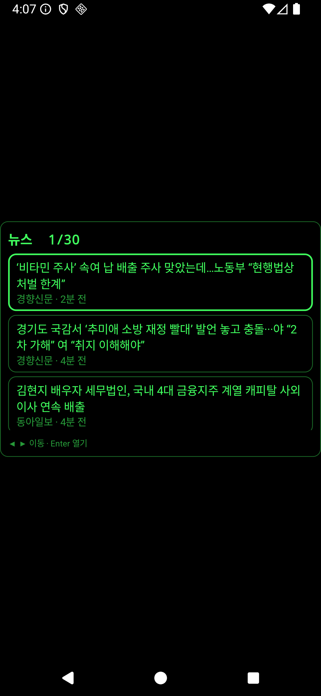
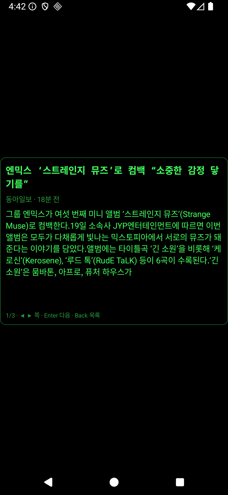
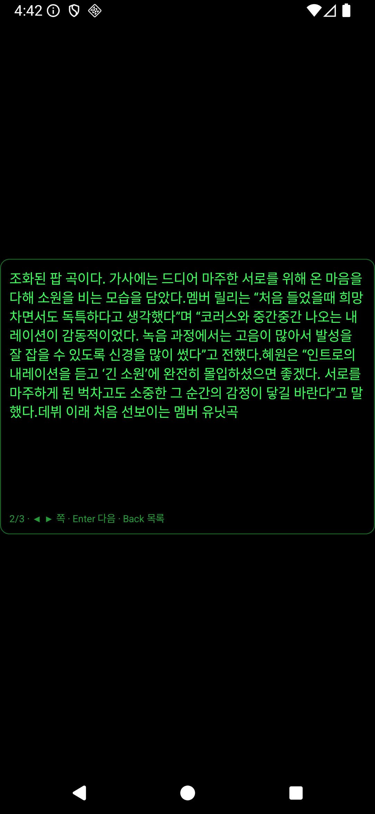
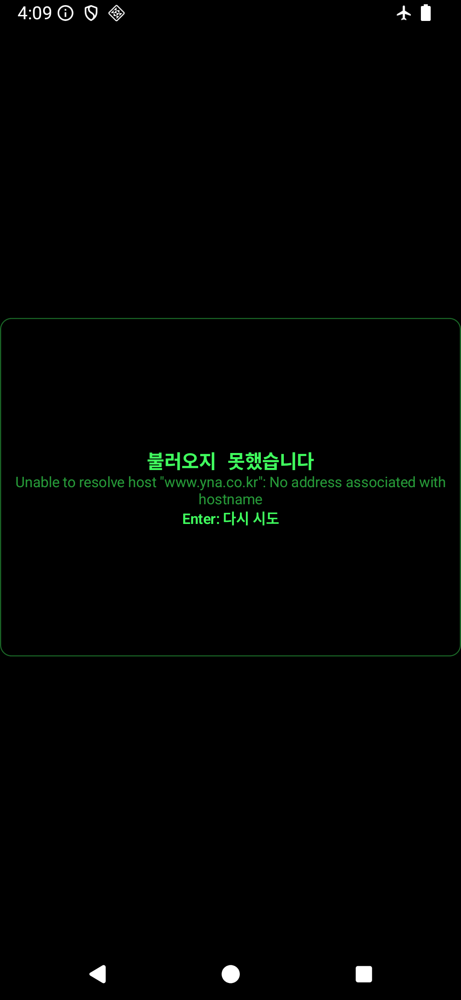
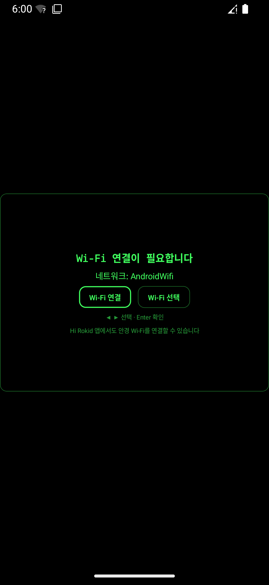
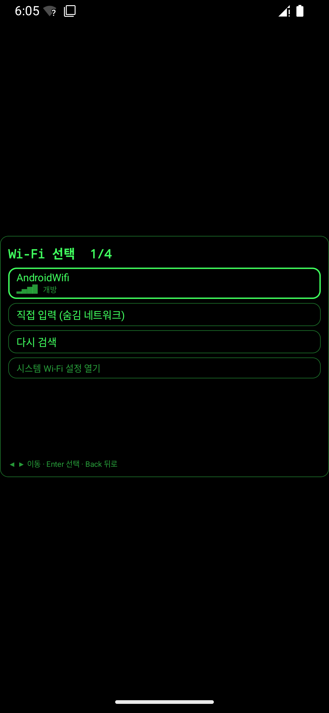
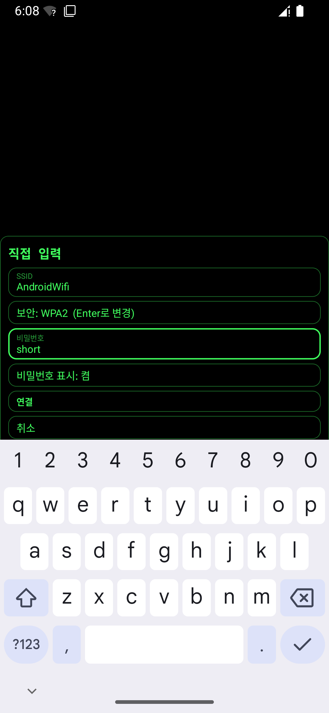
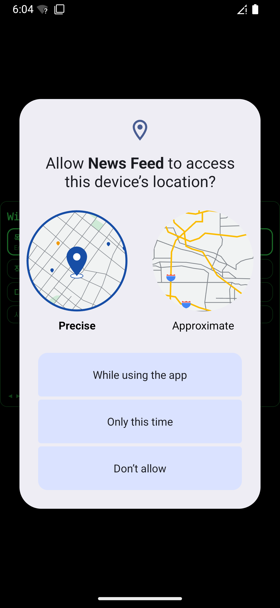
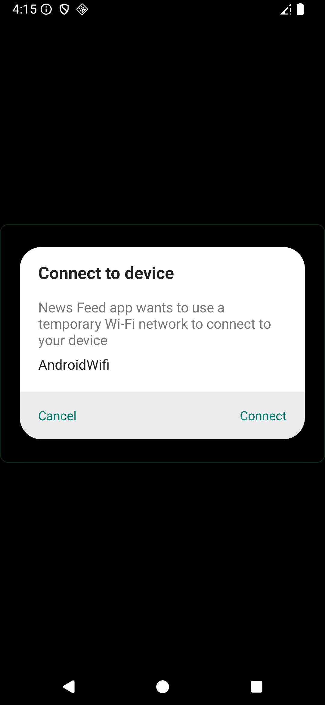
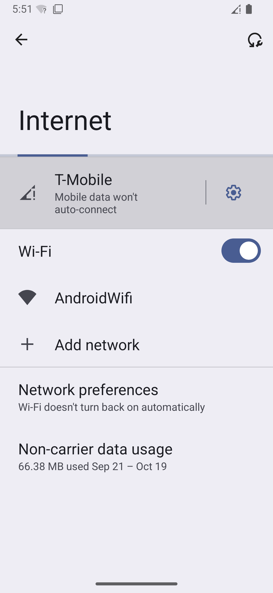

# news-feed 문서

연합뉴스·동아일보·경향신문 RSS를 **하나의 통합 목록**(언론사별 10개씩, 총 30개, 최신순)으로 보여 주고, 항목을 열면 상세(제목·언론사·기자·시간·요약·링크)를 보여 주는 Android 앱.
Rokid 글래스 단색 HUD 규격(480×352, 녹색)으로 만들었고 폰 에뮬레이터에서 검증했다.

| 통합 피드 | 상세 1쪽 | 상세 2쪽 | 오류 (전부 실패) |
|---|---|---|---|
|  |  |  |  |

| Wi-Fi 홈 | Wi-Fi 목록 | 직접 입력 폼 |
|---|---|---|
|  |  |  |

| 위치 권한 창(시스템) | "Wi-Fi 연결"의 시스템 확인 창 | 시스템 Wi-Fi 설정(보험) |
|---|---|---|
|  |  |  |

## 시작 시 Wi-Fi

앱을 켰을 때 인터넷이 없으면 Wi-Fi 화면이 먼저 뜬다. **OS 설정 화면이 아니라 이 앱의 HUD 화면**이고, 전부 ←/→/Enter/Back만으로 조작한다.

```
홈 ──[Wi-Fi 선택]──▶ 목록 ──[보안 네트워크 / 직접 입력]──▶ 폼(비밀번호)
 │                    └─ [시스템 Wi-Fi 설정 열기]  (보험)
 └─[Wi-Fi 연결]──▶ 저장된(또는 빌드 시) 네트워크에 바로 연결
Back: 폼 → 목록 → 홈 → 앱 종료
```

| 화면 | 내용 |
|---|---|
| **홈** | 지금 연결할 네트워크 이름과 버튼 2개. "Wi-Fi 연결"은 저장된 네트워크(없으면 빌드 시 `local.properties`의 값)에 바로 연결을 요청한다. "Wi-Fi 선택"은 목록으로 간다. |
| **목록** | 주변 네트워크를 신호가 강한 순으로 보여 준다(신호 막대 + 보안 종류). 개방형은 Enter로 바로 연결하고, WPA2/WPA3는 비밀번호 폼으로 간다. 기업망(802.1X)·WEP는 "지원하지 않는 보안 방식" 안내만 나온다. 맨 아래에 "직접 입력(숨김 네트워크)", "다시 검색", "시스템 Wi-Fi 설정 열기"가 있다. |
| **폼** | 비밀번호 입력칸(직접 입력이면 SSID·보안 종류도), "비밀번호 표시" 토글, 연결, 취소. 입력 규칙(WPA2 8~63자 또는 64자리 16진수, WPA3 1~128자)을 어기면 연결하지 않고 문구를 보여 준다. |

**비밀번호 입력**: 입력칸은 일반 안드로이드 텍스트 입력이라 폰의 키보드 앱이 보내는 글자를 그대로 받는다(Rokid Nexus의 "Keyboard & remote"와 같은 방식을 가정). ←/→/Enter는 입력칸에 먹히지 않도록 가로채서 항목 이동에 쓴다.

**저장**: 사용자가 직접 골라 연결에 **성공한** 네트워크만 저장한다. Android Keystore의 AES-256-GCM 키로 암호화해 앱 전용 저장소(`shared_prefs/wifi_saved.xml`)에 두며 SSID와 비밀번호는 평문으로 보이지 않는다(확인함). 백업은 꺼져 있고 로그·화면에 비밀번호를 내보내지 않는다. 저장된 값이 빌드 시 값보다 우선한다.

```bash
cp local.properties.example local.properties   # 선택: 저장된 네트워크가 없을 때 쓸 기본 Wi-Fi (커밋 금지)
```

**권한 — 안드로이드 규칙 때문에 위치 권한이 필요하다**
- `WifiManager.startScan()`/`getScanResults()`는 안드로이드 13+에서도 `ACCESS_FINE_LOCATION`이 필요하다. `NEARBY_WIFI_DEVICES`로는 대체되지 않는다(공식 문서 + 에뮬레이터 API 36에서 `SecurityException`으로 확인). 그래서 목록을 보려면 위치 권한을 허용해야 하고(정밀·대략을 함께 요청), 기기의 위치 서비스도 켜져 있어야 한다. 앱은 위치 정보를 쓰지 않는다.
- 이 권한 창은 **시스템 UI**(정밀/대략 + 3개 버튼, 터치 중심)라서 글래스에서 ←/→/Enter로 누를 수 있는지는 확인하지 못했다. 막히는 경우를 위해 목록 맨 아래에 "시스템 Wi-Fi 설정 열기"를 남겨 두었다. 목록을 못 보더라도 "직접 입력"은 권한 없이 쓸 수 있다.
- 연결 자체는 `WifiNetworkSpecifier`(위치 권한 불필요)이며, 연결된 네트워크는 **이 앱 프로세스에만** 적용된다. 첫 연결 때 시스템이 "Connect to device / Cancel · Connect" 확인 창을 띄우며 앱이 건너뛸 수 없다. 완전 자동은 아니다.

**그 밖의 동작**
- Wi-Fi 화면에 있는 동안 2초마다 인터넷 연결을 확인해, 시스템 설정이나 Hi Rokid 앱 등 어디서든 연결이 생기면 자동으로 피드를 불러온다.
- Wi-Fi 무선이 꺼져 있으면 안내 문구를 보여 준다(안드로이드 10+ 앱은 Wi-Fi를 직접 켤 수 없다).
- 화면 맨 아래의 "Hi Rokid 앱에서도 안경 Wi-Fi를 연결할 수 있습니다"는 Rokid Nexus 문서(`[2차]`, 제3자)에 근거하며 글래스에서 확인한 사실은 아니다.
- 폰의 Wi-Fi·모바일 데이터를 글래스가 그대로 쓸 수 있는지는 `rokid/docs/05-nexus-feature-control-patterns.md` 7장에 조사했다. 독립 APK가 폰 연결을 자동으로 쓰는 근거는 찾지 못했다.
- **WPA3**: 비밀번호가 필요한 WPA3는 `setWpa3Passphrase`로 요청하지만 실제 WPA3 AP로 시험하지 못했다.

## 실행

```bash
./gradlew testDebugUnitTest                 # 단위 테스트 (106개)
./gradlew assembleDebug                     # app/build/outputs/apk/debug/app-debug.apk
adb install -r app/build/outputs/apk/debug/app-debug.apk
adb shell am start -n dev.chorock.newsfeed/.MainActivity
```

## 조작

글래스는 **좌/우 조작만 가능하다고 가정**했다(공통 컨벤션 "Rokid 글래스 UI 입력 가정"). 확정(탭 = Enter)과 Back은 있다고 가정한 것이며 실기기에서 확인한 사실이 아니다.

| 입력 | 피드 | 상세 |
|---|---|---|
| ← / → | 이전 / 다음 기사 (**양끝에서 순환**: 1번에서 ←는 마지막, 마지막에서 →는 1번) | 이전 / 다음 **쪽** (양끝에서 **멈춤**) |
| Enter | 상세 열기 (오류 화면에서는 다시 시도) | 다음 쪽 (마지막 쪽에서는 멈춤) |
| Back | 앱 종료 | 목록으로 복귀 (선택 위치 유지) |
| ↑ / ↓ | **처리하지 않음** | **처리하지 않음** |

Wi-Fi 화면(홈·목록·폼)에서도 ←/→는 항목 사이를 순환하고 Enter는 선택한 항목을 누르며 Back은 한 화면씩 돌아간다. 폼의 입력칸에는 ←/→/Enter가 먹히지 않고 항목 이동에 쓰인다.

터치로 항목을 눌러도 열린다(에뮬레이터 확인용). 내비게이션 전체는 Android 없는 순수 상태머신(`nav/Navigator.kt`)이며 "어떤 키 순서로도 Back을 두 번 이내로 누르면 종료에 닿음"을 테스트로 검증한다.

## Nexus에서 가져온 설계 (참고: `rokid/docs/05-nexus-feature-control-patterns.md`)

| 방법 | 적용 | 위치 |
|---|---|---|
| 선택 순환 + 순수 내비게이션 상태머신 | 적용 | `nav/Navigator.kt`, `NavigatorTest` |
| 상세를 쪽 단위로 | 적용 | `util/Pager.kt`, `ui/DetailScreen.kt`, `PagerTest` |
| 응답 크기·리다이렉트·타임아웃 상한 | 적용 | `data/BoundedHttp.kt`, `BoundedHttpTest` |
| Wi-Fi 안내에 정식 경로 문구 | 적용 | `ui/WifiScreen.kt` |
| 읽은 기사 흐리게 + 목록 캐시 | 보류 | 저장소·만료 로직이 늘어나 이번 범위에서 제외 |

**쪽 나누기 상수** (`util/Pager.kt`): 첫 쪽 본문 220자(제목·메타가 함께 보임), 나머지 320자, 링크는 70자 분량으로 환산. 문단(`\n\n`) → 문장 끝 → 공백 순으로 자르며 문단·문장 끝은 예산의 절반 이후에서만 쓴다. 에뮬레이터에서 가장 긴 제목(50자)·가장 긴 본문(219자, 3쪽)으로 넘침이 없음을 확인했다.

**응답 상한** (`data/BoundedHttp.kt`): 본문 4MiB, 리다이렉트 4회, 연결·읽기 각 8초. http/https 외 스킴과 https→http 다운그레이드 리다이렉트는 거부한다.

## 구조

```
app/src/main/kotlin/dev/chorock/newsfeed/
├── MainActivity.kt              # 화면 상태(Wi-Fi 필요 여부, 피드 로딩, 선택/열린 항목), BackHandler
├── data/
│   ├── NewsApi.kt               # 언론사 3곳 병렬 다운로드 + 병합, 부분 실패 처리
│   ├── BoundedHttp.kt           # 크기·리다이렉트·타임아웃 상한이 있는 GET
│   ├── NewsMerge.kt             # 최신순 병합 (시각 불명은 맨 뒤)
│   ├── RssParser.kt             # <item> → Article (CDATA·엔티티·pubDate/dc:date)
│   └── Models.kt                # FeedSource, Article, Feed
├── nav/
│   ├── Navigator.kt             # 뉴스 내비게이션 상태머신 (NavKey/NavState/Reduction), wrapIndex
│   ├── WifiFlow.kt              # Wi-Fi 화면 묶음(홈/목록/폼) 내비게이션 상태머신 (순수)
│   └── WifiItems.kt             # 목록·폼의 줄 구성, 입력 검증 (순수)
├── net/
│   ├── WifiConfig.kt            # 연결할 네트워크(SSID/비밀번호/보안), 빌드 시 기본값
│   ├── WifiConnector.kt         # 온라인 확인, WifiNetworkSpecifier로 연결 요청(개방/OWE/WPA2/WPA3)
│   ├── WifiScanner.kt           # 주변 목록 스캔(위치 권한·위치 서비스 확인, 예외는 결과로)
│   ├── WifiSecurity.kt          # capabilities → 보안 종류, 비밀번호 규칙 검사 (순수)
│   ├── WifiNetworks.kt          # 스캔 결과 정리: 중복·숨김 제거, 신호순 정렬 (순수)
│   ├── WifiStore.kt             # Keystore AES-GCM으로 암호화해 저장
│   └── WifiSettings.kt          # 시스템 Wi-Fi 설정 화면 열기(보험)
├── ui/
│   ├── GlassFrame.kt            # 480×352 캔버스, 작은 화면에서는 비율 유지 축소
│   ├── Theme.kt                 # 글래스 색·글꼴 토큰
│   ├── FeedScreen.kt, DetailScreen.kt, LoadState.kt
│   ├── Keys.kt, NavStateSaver.kt  # 키 → NavKey 매핑(한 곳), 상태 보존
│   └── wifi/                    # WifiFlowScreen(호스트), WifiHomePage/PickerPage/FormPage, WifiWidgets(입력칸)
└── util/ Pager.kt, HtmlText.kt, TimeAgo.kt
```

## 뉴스 출처

2026-10-19에 직접 받아서 확인했다. 앱이 쓰는 UA(`news-feed/0.1`)와 UA 없는 요청 모두 같은 결과였다.

| 언론사 | RSS | 결과 | 요약 길이(중앙값) |
|---|---|---|---|
| 연합뉴스 | `https://www.yna.co.kr/rss/news.xml` | 200, 120개 | 83자 (일부는 거의 비어 있음) |
| 동아일보 | `https://rss.donga.com/total.xml` | 200, 50개 | 약 500자 |
| 경향신문 | `https://www.khan.co.kr/rss/rssdata/total_news.xml` | 200, 50개 | 약 200자 |

사용하지 않은 피드: 한겨레(`hani.co.kr/rss/`)는 요약이 모두 비어 있고 이미지 HTML만 온다. SBS는 790KB라 글래스에는 무겁다. 매일경제는 403(Cloudflare), KBS·YTN은 404, JTBC는 항목이 1개뿐이었다.
기사 저작권은 각 언론사에 있으며 앱은 RSS가 주는 제목·요약·링크만 보여 준다.

## 검증 결과 (2026-10-19)

**확인함** (직접 실행)
- `./gradlew testDebugUnitTest`: **73개 통과** (내비게이션 16, 쪽 나누기 15, 응답 상한 12, RSS 파서 9, 시간 6, HTML 변환 5, `NewsApi` 4, 병합 4, `WifiConfig` 2), 실패·건너뜀 0
  - 내비게이션에는 키 순서 1,000회 무작위 시나리오(고정 시드)가 있어 항상 Back 두 번 이내로 종료에 닿고 상태가 범위를 벗어나지 않음을 확인
  - 응답 상한은 로컬 HTTP 서버로 리다이렉트 따라가기·한도 초과·`Location` 없음·허용하지 않는 스킴·본문 한도를, 순수 `nextUrl`로 https→http 거부를 확인
- `./gradlew assembleDebug` 성공(경고 없음)
- 에뮬레이터 `Galaxy_S26` (API 36)에서 통합 피드 30개가 경향신문·동아일보·연합뉴스 기사로 시간순으로 섞여 표시
- **←/→/Enter/Back만으로** 동작, ↑↓는 무시:
  - 순환: 1/30에서 ← → 30/30, 30/30에서 → → 1/30
  - 상세는 쪽 단위: 기사 30개를 모두 열어 쪽 수 분포 확인(1쪽 12, 2쪽 11, 3쪽 7), → / Enter로 다음 쪽, 마지막 쪽에서 →·Enter를 더 눌러도 멈춤, 첫 쪽에서 ←를 5번 눌러도 멈춤
  - Back: 상세 → 목록(26/30 위치 유지), 목록 → 앱 종료(포그라운드가 런처로 바뀜. 프로세스는 안드로이드가 캐시로 남김)
  - 상세에서 ↓를 눌러도 쪽이 바뀌지 않음
- 실제 피드 3곳이 새 `BoundedHttp`로 정상 로딩. 동아일보·경향신문 서버는 gzip으로 응답하는데 두 곳 기사가 정상 파싱되므로 Android의 자동 압축 해제가 동작함을 확인(연합뉴스는 `HEAD`가 405라 gzip 여부를 확인하지 못함)
- 이번 작업 중 찾아 고친 버그: 요약의 `&apos;`가 `&apos;` 그대로 표시됨 → `htmlToText`에서 복원(테스트 추가)
- 비행기 모드(전부 실패) → "불러오지 못했습니다 / Enter: 다시 시도", 오류 화면에서 →는 무시, 네트워크 복구 후 Enter → 통합 피드 30개 복구 (통합·쪽 나누기 도입 전에 확인한 화면이며 Nav 리팩터링 뒤에는 Wi-Fi 경로로만 다시 확인)

- **Wi-Fi 연결** (에뮬레이터, 개방형 `AndroidWifi`): 모바일 데이터를 끄고 저장된 연결을 지운 상태로 시작 → Wi-Fi 연결 화면 → Enter → 시스템 확인 창 → Connect → 앱이 `AndroidWifi`에 연결(요청 패키지 `dev.chorock.newsfeed`)되고 피드 30개 자동 로딩
- 확인 창에서 Cancel → "AndroidWifi에 연결하지 못했습니다" 표시, 버튼은 다시 사용 가능
- Wi-Fi 무선을 끄고 Enter → "Wi-Fi가 꺼져 있습니다. 먼저 켜 주세요" 표시
- **Wi-Fi 화면(직접 만든 HUD UI)** — 전용 에뮬레이터 `NewsFeed_Test`(API 36, 오프라인으로 시작), `adb -s emulator-5556`만 사용:
  - 홈에 버튼 2개, ←/→로 선택 이동
  - 목록: 권한이 없으면 맨 위에 "목록을 보려면 위치 권한 허용"과 직접 입력·다시 검색·시스템 설정 줄. Enter → 시스템 위치 권한 창 → "앱 사용 중 허용" → `AndroidWifi`(신호 막대 4칸, 개방)가 목록에 나옴
  - 목록에서 `AndroidWifi` 선택 → 시스템 확인 창 → Connect → 피드 30개 로딩. 저장 파일에 SSID·비밀번호가 평문으로 없음(암호화된 `blob`만)
  - 앱을 끄고 오프라인으로 다시 시작 → 홈의 "Wi-Fi 연결"이 저장된 네트워크로 연결 → 피드 로딩
  - 직접 입력 폼: `adb input text`로 SSID와 비밀번호 칸에 글자가 들어감(폰 키보드가 보내는 글자를 받는 경로의 대용), 표시 토글로 평문 확인, 5자는 "WPA2 비밀번호는 8자 이상이어야 합니다"로 거부, 10자는 연결을 시도해 시스템 "Searching for device…" 후 앱이 죽지 않고 "AndroidWifi에 연결하지 못했습니다"를 보여 주고 입력값은 유지
- **버그 두 건을 실행해서 찾아 고쳤다**
  - `CHANGE_WIFI_STATE` 권한 누락으로 스캔 요청이 `SecurityException`을 던져 앱이 죽었다 → 권한을 선언하고 `WifiScanner`가 스캔 중 모든 예외를 결과로 바꾸게 했다
  - 목록이 비어 있었다: 로그가 "UID has no location permission". `NEARBY_WIFI_DEVICES`로 충분하다고 가정했으나 안드로이드 13+에서도 `startScan`/`getScanResults`는 `ACCESS_FINE_LOCATION`이 필요하다 → 위치 권한 방식으로 바꿨다
- 상세·내비게이션 리팩터링 뒤에 같은 Wi-Fi 흐름을 다시 확인: 오프라인 시작 → 연결 화면(안내 문구 포함) → Enter → 시스템 창 → Connect → 피드 30개 로딩

**미검증 / 알려진 한계**
- **글래스에서 위치 권한 창을 누를 수 있는지**(시스템 UI, 터치 중심)는 확인하지 못했다. 이 창이 막히면 목록은 못 보고 "직접 입력"과 "시스템 Wi-Fi 설정 열기"만 쓸 수 있다
- 시스템 Wi-Fi 설정·시스템 연결 확인 창도 글래스에서 ←/→/Enter만으로 조작되는지, 글래스 OS(YodaOS-Sprite)에 설정 앱이 있는지는 확인하지 못했다
- **보안 네트워크(WPA2/WPA3)로 실제로 연결되는지**: 에뮬레이터에는 개방형 AP만 있어 확인하지 못했다. 비밀번호 입력·검증·거부 경로와 요청 생성까지만 확인했다. 목록에 보안 네트워크가 나올 때(잠금 표시, 폼으로 이동)의 화면도 직접 보지 못했다(`securityOf`와 항목 구성은 단위 테스트)
- 폰 키보드가 글래스 입력칸에 글자를 보내는 실제 경로(Nexus의 "Keyboard & remote" 등)는 시험하지 못했다. `adb input text`는 같은 입력칸이 글자를 받는다는 것만 보여 준다
- 위치 서비스가 꺼진 기기에서의 안내 문구("기기의 위치 서비스를 켜야 …")와 권한을 거부했을 때의 화면은 직접 보지 못했다
- 소프트 키보드가 있는 기기(에뮬레이터)에서는 키보드가 폼 아래쪽(오류 문구·취소 줄)을 가린다. 글래스에 소프트 키보드가 없다는 가정이다
- 비밀번호 칸의 글자 가림(`PasswordVisualTransformation`)과 자동 완성 비활성은 설정만 했다(접근성 덤프에서 `password=true` 확인)
- 쪽 나누기 상수(220/320/70)는 한국어 샘플 30건과 에뮬레이터 프레임(480×352dp)에서만 맞춘 값이다. 실제 글래스의 글꼴·밀도에서 줄 수가 달라질 수 있다. 문단 구분(`\n\n`)이 많은 글은 빈 줄만큼 줄이 늘어 여유가 줄어든다
- 연합뉴스 응답의 gzip 여부(`HEAD`가 405라 확인하지 못함)
- 비밀번호가 있는 네트워크(WPA2)로의 연결: 에뮬레이터에는 개방형 AP만 있어 확인하지 못했다. 코드는 `setWpa2Passphrase`를 쓰지만 실제로 붙는지는 미검증이다
- `wifi.ssid`가 비어 있을 때의 "설정되지 않았습니다" 안내 화면은 빌드를 바꿔 보지 않았다(`WifiConfig.isConfigured`는 단위 테스트로만 확인)
- 글래스 실기기에서 시스템 확인 창(Cancel/Connect)을 ←/→/Enter만으로 누를 수 있는지, 글래스 OS(YodaOS-Sprite)가 `WifiNetworkSpecifier`를 지원하는지는 확인하지 못했다. 이 창은 시스템 UI라 앱이 입력 방식을 바꿀 수 없다
- Rokid 글래스 실기기 설치·동작, 글래스가 실제로 보내는 키 코드. 참고로 AIUI 공식 문서는 Rokid Glasses의 키로 `ArrowUp`/`ArrowDown`도 든다. "좌우만 가능"은 사용자 가정이다
- 에뮬레이터에서 일부 언론사만 실패하는 화면(푸터의 "OO 실패" 문구)은 직접 보지 못했다. 로직은 단위 테스트로만 확인했다
- 릴리스 서명 APK (debug 서명만 사용)
- 요약은 RSS가 주는 만큼이다. 연합뉴스는 짧고, 경향신문은 사진 설명과 본문이 이어 붙어 온다(피드 원문 그대로). 본문 전체는 가져오지 않는다
- 원문 링크는 텍스트로만 보여 주고 브라우저를 열지 않는다
- 정규식 파서이므로 다른 형식(Atom 등)이나 같은 이름 태그가 중첩된 피드는 처리하지 않는다
- 피드 주소는 언론사가 바꿀 수 있어 시간이 지나면 깨질 수 있다
- 480×352는 dp 기준 고정 캔버스다. 실제 글래스의 픽셀/밀도에서 어떻게 보이는지는 확인하지 못했다
